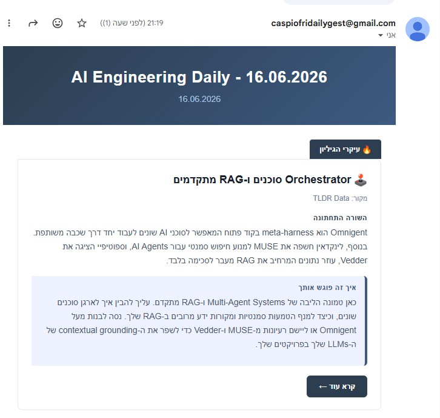
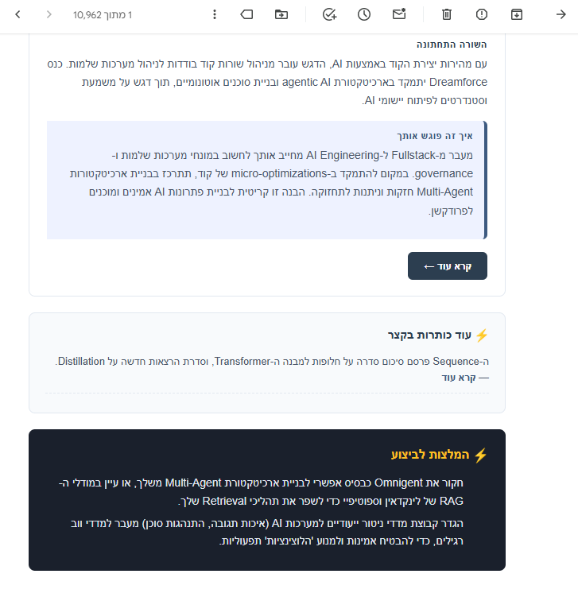
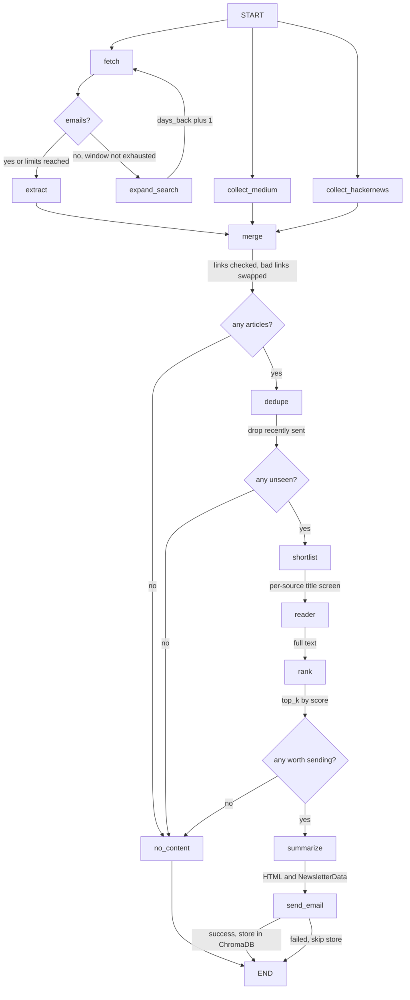

# Newsletter Agent

An end-to-end multi-source AI pipeline. Parallel collectors gather articles from your Gmail newsletters, Medium tag feeds and Hacker News; a reader fetches the full text of a shortlist; an LLM ranker picks the best; and a personalized Hebrew digest is delivered to your inbox — fully automated, daily.

Built with LangGraph and Google Gemini 2.5. Each run is judged by Claude Haiku 4.5, a different model family from the writer and ranker, and traced in LangSmith. A multi-criteria LLM-as-judge eval harness covers offline checks.

---

## Demo

| Top of digest | Full issue |
|---|---|
|  |  |

---

## Architecture

The pipeline is a **stateful LangGraph graph**. Three collectors run **in parallel** from `START` and join in `merge`; the rest is a sequential funnel that narrows hundreds of candidates to the few stories worth sending.

The inbox collector keeps its retry loop. Two independent knobs control it: `max_days_back` (how far back in time to search) and `max_tries` (transient failure retries). If neither limit is reached and no emails are found, the window widens by one day and it retries. When the inbox stays empty the run continues with the other collectors instead of stopping.



### Node responsibilities

| Node | What it does |
|---|---|
| `fetch` | Gmail API → decode MIME parts → `list[Article]` (one per email) |
| `extract` | Parallel Gemini calls — explodes each email into sub-articles. Links are read from the HTML in code and Gemini picks from a numbered list, so a URL can never be invented |
| `expand_search` | Widens the inbox search window (`days_back + 1`) when no emails found |
| `collect_medium` | Polls Medium tag RSS feeds (`medium.com/feed/tag/<tag>`); Medium has no API |
| `collect_hackernews` | Recent, well-voted Hacker News stories for the configured queries (Algolia API) |
| `merge` | Join point: de-duplicates by URL, classifies every link, and replaces a bad link with a direct link to the same story from another source |
| `dedupe` | ChromaDB vector search — drops articles already sent within the last 3 days, before they can take a shortlist slot |
| `shortlist` | Gemini title screen run separately per source (quota per source), so one noisy source cannot crowd out the others. Gemini picks articles by integer id, so a title can no longer be invented or mismatched |
| `reader` | Fetches full article text for the shortlist in parallel (`trafilatura`). Marks each `full`, `partial` or `snippet` |
| `rank` | One Gemini call scores each candidate 0-10 on its content and source (curated newsletter, unvetted Medium feed, HN points). Articles read only as a snippet are capped at 6 in code |
| `summarize` | Gemini reads up to `READ_MAX_CHARS` (6000) characters of each article (via the shared `article_text()`) and writes full newsletter JSON → rendered to HTML. Cards reference articles by integer id and `card_resolver.resolve_cards` maps each id to the real URL, so a URL cannot be invented. Cards of Medium or Hacker News articles that were only read as a snippet are demoted to one-line brief items (inbox articles are exempt). A link that is dead or cannot be verified renders as a gray, disabled button |
| `send_email` | Gmail API sends the HTML digest; stores articles in ChromaDB only on success |
| `no_content` | Terminal node when no sendable articles exist |

### Link handling

Every article link is classified in `merge`: `ok`, `dead` (404/410), or `unverified` (a Cloudflare bot challenge, so a script cannot tell). A story whose link is not `ok` gets the URL of the same story from another newsletter when one exists (embedding similarity, the same model as dedupe). The shortlist prefers stories with working links. If only a bad link remains, the card shows a gray "link unavailable" button instead of a link that may 404.

---

---

## Newsletter structure

Each digest is compiled into three sections by the LLM:

- **עיקרי הגיליון** (Top stories) — articles scoring ≥ 6/10 relevance. Each card has:
  - *השורה התחתונה* — 1–2 sentence factual summary, no fluff
  - *איך זה פוגש אותך* — personalized angle connecting to the reader's stack (RAG, LangGraph, multi-agent)
- **עוד כותרות בקצר** (Brief) — lower-relevance articles as one-liners
- **המלצות לביצוע** (Actions) — 1–2 specific, executable recommendations grounded in today's articles

The LLM is given a structured output schema (Pydantic → JSON) so the HTML renderer never touches raw prose.

---

## Eval harness

`evals/eval.py` runs three nodes against fixture data — **no Gmail required** — and produces a quality report.

**Fixture set:** 6 AI-engineering articles + 2 deliberately off-topic (startup funding, health study) to test filter discrimination.

### Structural checks (rule-based)

| Check | What fails it |
|---|---|
| HTML parseable | BeautifulSoup parse error |
| has header | `.header` class missing |
| has full card | no `.card` element |
| has brief section | no `.brief-section` element |
| has actions section | no `.actions-section` element |
| no `dir=ltr` elements | RTL layout broken |

### LLM-as-judge scores (1–5 each)

| Criterion | Rubric |
|---|---|
| **Faithfulness** | Every factual claim traceable to source articles; no hallucination |
| **Hebrew quality** | Fluent prose; technical terms (RAG, LLM, API) kept in English |
| **Personalization** | Advice is concrete and specific to the target audience's stack |
| **Actionability** | 1–2 immediately executable actions tied to today's articles |

The third eval suite covers the `dedupe` node — four cases: empty store passes all, seen articles are blocked, genuinely new articles pass through, and mixed batches return only the unseen subset.

Run it:

```bash
python -m evals.eval
# Results printed as a table and saved to output/eval_<timestamp>.json
```

### Ranking ground truth (labeling report)

Every run writes `output/ranking_<profile>_<timestamp>.html` (plus a `.json`): every candidate the ranker scored, plus a seeded random sample of articles it never saw, so false negatives are visible. Open the page in a browser and rate each article **Must-read / Worth it / Skip** with an optional reason. It hides the ranker's scores until you tick "show ranker score and picks", so your labels are not anchored by them, and it shows the text snapshot the ranker saw. Progress is kept in the browser. "Export labels" downloads a JSON file, which you merge into the golden set:

```bash
python -m evals.import_labels output/ranking_labels_ai_<run>.json
# -> evals/ranking_golden.json (keyed by URL, with a text snapshot so labels survive link rot)
```

### Live trace judging (`modules/trace_judge.py`)

`evals/eval.py` tests nodes in isolation against fixtures. `modules/trace_judge.py` complements it by judging a **real pipeline run** end-to-end — called automatically after every successful `graph.ainvoke()`.

The judge sees exactly the text the summarizer saw (the same `article_text()`), judges each card against its own source article by id, and runs on Claude (`JUDGE_MODEL_DAILY`, `claude-haiku-4-5`) rather than Gemini. Its scores and reasoning are posted to LangSmith as feedback (see Monitoring). `JUDGE_MODEL_EVAL` (`claude-sonnet-5-5`) is the stronger judge for on-demand evals.

It scores three stages on a 1–5 scale:

| Stage | Method | What it measures |
|---|---|---|
| `fetch_health` | Rule-based | Loop efficiency — how many retries before articles were found; penalises stagnation and hard-limit hits |
| `filter_quality` | LLM judge | Whether the selected top-k articles are genuinely the most relevant to the configured subject |
| `content_faithfulness` | LLM judge | Whether every factual claim in the generated cards is traceable to a source article — no hallucinated details |

After each run the report is printed to stdout as a scored bar chart and saved to `output/trace_<profile>_<timestamp>.json`:

```json
{
  "profile": "AI",
  "overall": 4.3,
  "stages": [
    { "stage": "fetch_health",       "score": 5, "reasoning": "Fetched 24 articles on the first attempt." },
    { "stage": "filter_quality",     "score": 4, "reasoning": "Selected articles closely match the AI engineering subject." },
    { "stage": "content_faithfulness","score": 4, "reasoning": "All card claims supported by source snippets." }
  ]
}
```

> This pattern — attaching a lightweight LLM judge to every live trace rather than only to offline evals — aligns with LangChain's [Building a 100x Cheaper Trace Judge](https://blog.langchain.dev/building-a-100x-cheaper-llm-judge/) (June 15, 2025).

---

## Reliability

Every Gemini call is wrapped in **tenacity** — 3 retries with exponential backoff (2 s → 4 s → 8 s). The full graph execution runs inside a **600-second asyncio timeout** so a hanging API call never blocks the daily run.

---

## Monitoring

The pipeline runs unattended via cron (`0 7 * * *`, daily). Two layers catch failures:

- **LangSmith tracing** — every graph run is traced end-to-end (`LANGSMITH_TRACING=true`, `LANGSMITH_API_KEY` and `LANGSMITH_PROJECT` in `.env`; the legacy `LANGCHAIN_TRACING`, `LANGCHAIN_API_KEY` and `LANGCHAIN_PROJECT` names are still read by the SDK), so a run's node-by-node behavior is inspectable after the fact.
- **healthchecks.io dead-man's-switch** — `main.py` pings `HEALTHCHECK_PING_URL` after every run: a plain ping on success, `/fail` (with the error or failed profile) on a crash, graph timeout, or `email_status == "failed"`. The check has a 60-minute grace period, so if the run never happens at all — for example the host machine is down — healthchecks.io alerts on the *missing* ping, which nothing running on the host itself could otherwise detect.

### What you can see in LangSmith

- **One `digest_run` trace per day**, tagged `digest_run` and the profile. It contains the node runs, the dedupe lookup (a retriever run named `dedupe_lookup`, with the matched sent titles and their similarity as documents), every `gemini` call, and the `trace_judge` run. The Claude call is the run named `judge_llm` (run type `llm`), tagged with the judge model id.
- **Feedback on that root run:** `judge.filter_quality`, `judge.content_faithfulness`, `judge.fetch_health` (always posted) and `judge.overall` (the judge's scores, with reasoning as the comment), plus `stat.<name>` for each pipeline stage count: `stat.merged`, `stat.after_dedupe`, `stat.dedupe_dropped`, `stat.dedupe_matches`, `stat.dedupe_near_misses`, `stat.dedupe_batch_duplicates`, `stat.dedupe_max_similarity`, `stat.shortlisted`, `stat.read_full`, `stat.read_partial`, `stat.read_snippet`, `stat.ranked`, `stat.picked`, `stat.cards`, `stat.brief_items`. Add the feedback keys as columns in the runs table.
- **Root run metadata `run_summary`:** the picked titles, the ranker's scores and reasons for every candidate, and the dedupe drops.

`stat.dedupe_dropped` counts every article the dedupe step removed, including duplicates within one batch. `stat.dedupe_matches` and `stat.dedupe_near_misses` count the matches at or above and just below the threshold, `stat.dedupe_batch_duplicates` the duplicates within one batch, and `stat.dedupe_max_similarity` the highest similarity among the matches (0.0 when there are none). `run_summary.dedupe_drops` lists only matches against previously sent stories and near-misses, each with its similarity, the matched sent article and its send date; `dropped: true` means the similarity was above the threshold.

Prompts are recorded, so article and newsletter text is uploaded to LangSmith.

---

## Tech stack

| Layer | Choice | Why |
|---|---|---|
| Orchestration | LangGraph | Stateful graph with parallel fan-out/fan-in, conditional edges and checkpointing |
| LLM | Gemini 2.5 Flash | Extended thinking budget for the summarize step; cost-effective for daily runs |
| Trace judge | Claude Haiku 4.5 (`claude-haiku-4-5`) | A different model family from the writer and ranker, so the judge does not grade its own work; cheap enough for every run |
| Observability | LangSmith | One `digest_run` trace per day with judge scores and stage counts as feedback |
| Email | Gmail API (OAuth 2.0) | Native read + send from an existing inbox, no extra infra |
| Data modeling | Pydantic | Structured LLM output that fails loudly on schema violations |
| Deduplication | ChromaDB + sentence-transformers | Vector similarity dedupe prevents resending articles seen in the last 3 days |
| Fault tolerance | tenacity + asyncio timeout | Handles transient LLM failures without manual intervention |
| Full-text reading | trafilatura | Extracts the main article text from a fetched page |

---

## Setup

### Prerequisites

- Python 3.10+
- Google Cloud project with Gmail API enabled
- `config/credentials.json` (OAuth 2.0 Desktop App) from the Cloud Console
- Gemini API key
- Anthropic API key (for the Claude trace judge)
- LangSmith API key (optional, for tracing)

### Install

```bash
pip install -r requirements.txt
```

### Configure

Copy `.env.example` and fill in your values:

```bash
cp .env.example .env
```

`.env.example` also lists `ANTHROPIC_API_KEY` (the trace judge) and the LangSmith variables `LANGSMITH_TRACING=true`, `LANGSMITH_API_KEY` and `LANGSMITH_PROJECT`. `requirements.txt` includes `anthropic` and `langsmith`.

The active collectors have defaults in `config/settings.py`. Override them per profile in `.env` with comma-separated lists, for example `AI_MEDIUM_TAGS=ai-agents,llm,rag` and `AI_HN_QUERIES=LLM,AI agents`. Shortlist quotas, the minimum rank score and the snippet cap are in the same file.

### First run — Gmail auth

The first run opens a browser for OAuth consent and saves `config/token.json` for subsequent runs.

```bash
python main.py
```

---

## Project structure

```
├── main.py               # Entry point — invokes the compiled graph (cron runs this)
├── modules/              # Application code
│   ├── graph.py          # LangGraph node wiring and conditional edges
│   ├── nodes.py          # Node implementations (fetch, extract, collect, merge, dedupe, shortlist, rank, summarize, send)
│   ├── collectors/       # Active sources: medium.py (tag RSS), hackernews.py (Algolia API)
│   ├── reader.py         # Full-text fetching for shortlisted articles
│   ├── article_text.py   # article_text(): the one text view of an article, shared by the summarizer and the judge
│   ├── card_resolver.py  # Maps summarizer ids to real URLs, drops bad/duplicate ids, demotes snippet-only external cards
│   ├── judge_llm.py      # Claude transport for the trace judge (JUDGE_MODEL_DAILY / JUDGE_MODEL_EVAL)
│   ├── tracing.py        # LangSmith feedback and run_summary metadata for the digest_run root run
│   ├── ranking_report.py # Ranking report + HTML labeling page
│   ├── state.py          # DigestState TypedDict — shared across all nodes
│   ├── models.py         # Article, ArticleCard, NewsletterData Pydantic models
│   ├── gmail_client.py   # Gmail API wrapper (auth, read, send)
│   ├── link_utils.py     # Real-link extraction from email HTML, tracking unwrap, dead-link check
│   ├── article_store.py  # ChromaDB vector store — deduplication and article retention
│   └── trace_judge.py    # Per-run LLM-as-judge with 3-stage scoring
├── config/               # settings.py (all paths) + credentials.json, token.json, service_account.json (git-ignored)
├── evals/                # Offline eval harness — eval.py, eval_golden.py, golden_set.json, import_labels.py
├── tests/                # Offline unit tests — python -m tests.test_link_utils, test_collectors, test_article_text, test_card_resolver, test_summarize_ids, test_shortlist_ids, test_trace_judge, test_judge_llm, test_pipeline_evidence, test_tracing, test_eval_golden (each via `python -m tests.<name>`)
├── data/                 # Runtime data: chroma_db/ (git-ignored)
├── output/               # Logs, trace reports, eval reports (git-ignored)
├── docs/                 # Screenshots
└── requirements.txt
```

Run everything from the repo root. All file locations come from `config/settings.py`, so the working directory no longer matters for data and credentials.
